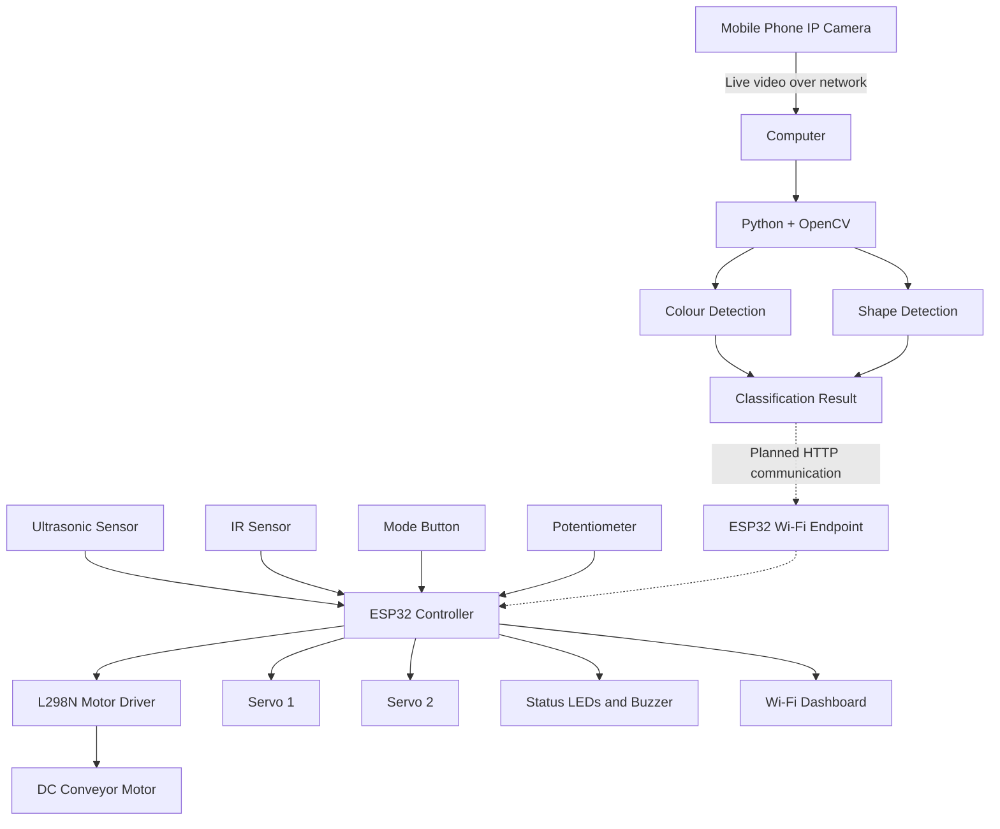

# System Architecture

## 1. Overview

The Vision-Based Automated Conveyor Sorting System combines computer vision, embedded control, sensors and a conveyor mechanism to identify objects and sort them according to their characteristics.

The system consists of three main subsystems:

- **Vision subsystem:** A mobile phone acts as an IP camera and streams video to a computer running Python and OpenCV.
- **Embedded control subsystem:** An ESP32 processes sensor inputs and controls the conveyor motor, sorting servos and status indicators.
- **Communication subsystem:** Wi-Fi is the planned interface for sending vision classifications from the computer to the ESP32.

The current ESP32 firmware supports manual product selection through a Wi-Fi dashboard. Automatic vision-driven sorting requires additional integration.

## 2. System Architecture Diagram

**Diagram notation:** Solid arrows represent the main architecture and control relationships. Dashed arrows represent the planned vision-to-ESP32 integration, which is not yet implemented in the supplied firmware.

## 3. Vision Processing Workflow

1. The mobile phone IP camera provides a live video stream.
2. The computer captures frames using OpenCV.
3. The vision module processes the image.
4. The colour detector identifies a configured colour, or the shape detector attempts to identify a basic geometric shape.
5. The classification result is prepared for communication to the ESP32.
6. After the communication endpoint is implemented, the ESP32 can validate the result and initiate the appropriate sorting action.

The current Python scripts run independently and do not yet complete steps 5–6 as an integrated automatic sorting workflow.

## 4. Embedded Control Workflow

The current ESP32 firmware uses a state-based control sequence.

1. **Idle:** The conveyor motor remains stopped while the controller monitors the ultrasonic sensor.
2. **Object detection:** An object within the configured ultrasonic distance triggers conveyor feeding.
3. **Conveyor feeding:** The motor runs until the IR sensor detects the object.
4. **Waiting for selection:** The conveyor stops and the dashboard accepts a manual product selection.
5. **Sorting action:** The firmware commands the relevant servo and restarts the conveyor.
6. **Servo return:** After the configured hold period, the servos return to their configured home position.
7. **Object clearing:** The conveyor continues until the IR sensor no longer detects the object.
8. **Idle:** The controller stops the motor and waits for the next object.

The existing firmware is the reference for this manual operating sequence.

## 5. Hardware and Software Responsibilities

| Component | Responsibility |
|---|---|
| Mobile phone IP camera | Supplies live video |
| Python | Runs the vision-processing scripts |
| OpenCV | Captures and processes video frames |
| NumPy | Supports image and array operations |
| ESP32 | Runs the control logic and Wi-Fi dashboard |
| Ultrasonic sensor | Detects objects within the configured proximity range |
| IR sensor | Detects an object at the conveyor's sensing position |
| Potentiometer | Provides the motor-speed control input |
| L298N motor driver | Drives the DC conveyor motor |
| Servo motors | Operate the sorting mechanism |
| LEDs and buzzer | Provide status and feedback |

## 6. Network Architecture

The current ESP32 firmware creates a Wi-Fi access point:

- **Network:** `Sorting-Conveyor`
- **Dashboard address:** `http://192.168.4.1`
- **HTTP port:** `80`

The mobile phone IP camera uses a separate stream address, currently configured in `vision/camera_config.py`.

The computer must be able to reach both the camera stream and the ESP32 endpoint. Depending on the network setup, this may require a shared router, multiple network interfaces or a change to the ESP32 networking configuration.

The planned classification endpoint is `POST /classification`. The current firmware does not implement this route.

## 7. Current Implementation Status

| Subsystem | Status |
|---|---|
| Mobile phone IP camera stream | Previously tested |
| Initial colour detection | Developed |
| Basic shape detection | Developed; further testing required |
| ESP32 manual-control dashboard | Implemented in the supplied sketch |
| Ultrasonic and IR control sequence | Implemented in the supplied sketch |
| Potentiometer-based PWM control | Implemented in the supplied sketch |
| Servo-based manual sorting | Implemented in the supplied sketch |
| Wi-Fi classification endpoint | Pending |
| Automatic vision-driven sorting | Pending integration and validation |

## 8. Future Integration

The next integration stage should introduce the HTTP classification handler into the ESP32 firmware while preserving its existing dashboard and motor-control state machine.

The integration should validate incoming messages, reject unsupported classifications, handle network failures and prevent repeated messages from causing unintended sorting actions.

The complete system should only be described as automatically sorting objects after the camera, vision processing, Wi-Fi communication and physical sorting cycle have been tested together.

## 9. Safety Considerations

The ESP32 should remain responsible for motor and servo control. Python should provide classification results rather than directly controlling hardware pins.

Verify sensor voltage levels, motor-driver wiring, servo power and mechanical clearances before performing full-system tests.
